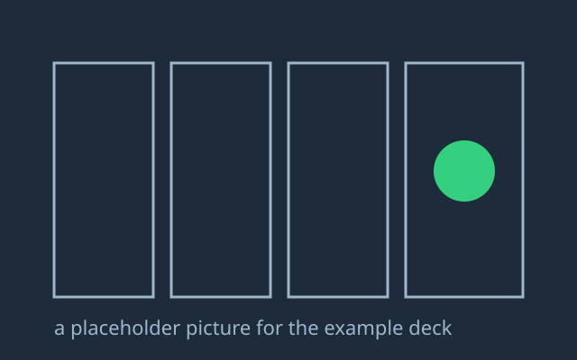

## The same week {.stage view="1946-1954" grow="1949.7" now="1949-06-09" lit="x1949" colours="false" ends="false"}

::: {.caption}
**9 June 1949.** Two lines begin in the same week. The caption sits top left; its bold lead-in is set as the date. Click the ringed point to open its picture.
:::

::: {.plate}

A plate holds the evidence, shown whole, with its label beneath.
:::

## The strands meet {.stage view="1946-1956" grow="machine:1954.6"}

::: {.caption}
**1952.** The strands bow together at the oration and at the broadcast, then one of them ends.
:::

## 1960 {.stage view="1955-1970" grow="1964" now="1960" lit="maisie"}

::: {.caption}
**1960, the eleven-plus.** The first fork. The fork's label sits on the incoming line, each branch is named where it levels off, and the unlit line is a ghost without words.
:::

## 1960, same state {.stage now="1960"}

::: {.pin year=1960 side=above align=right}
A slide repeats the view and growth of the one before; `now` and `lit` are per slide. This is a pin: a free note tied to a year.
:::

## 1965 {.stage view="1946-1975" grow="maisie:1972 machine:1966" lit="x1965 b84 b91"}

::: {.pin year=1965 side=below}
She solders the machine. Two branches are lit; the rest dim.
:::

## Who turns the wheel {.stage view="1955-2015" grow="2014"}

::: {.pin year=1999 side=mid align=left}
A shared fork from `forks-on` marks every branch and is labelled once.
:::

## Except here {.stage dim="true"}

::: {.cover tone=dark}
A cover over a dimmed stage. Markdown inside works: *emphasis*, lists, images.
:::

## An ordinary slide

- The stage hides on any slide without the `stage` class.
- Everything else in Quarto works as normal here.

## Four women {.stage view="1946-2045" grow="2040" colours="true" ends="true" lit="ghost"}

::: {.caption width=wide}
**Endings.** Colours and end-labels appear. The unknown id `ghost` in `lit` is ignored with a console warning.
:::
